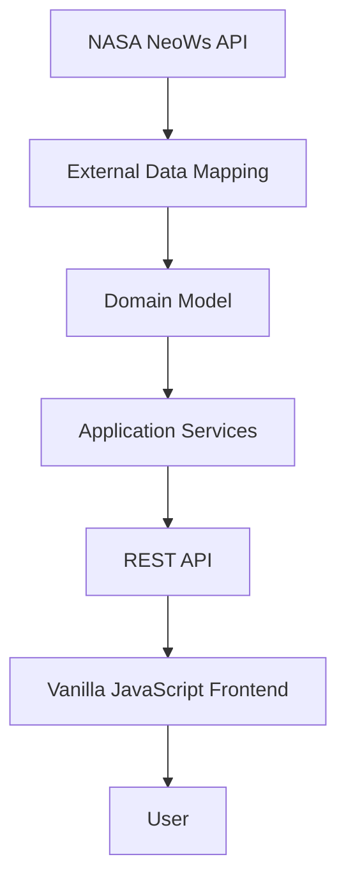

# Close To Us

**A Near-Earth Object monitoring platform powered by NASA data.**

Close To Us is a web application that retrieves, processes, and displays information about Near-Earth Objects (NEOs) using NASA's [Near Earth Object Web Service (NeoWs)](https://api.nasa.gov/).

The platform provides an accessible way to explore asteroids approaching Earth, inspect their physical characteristics, and monitor their proximity, relative velocity, and potential hazard classification.

## Overview

Close To Us integrates NASA's astronomical data into a dedicated application, combining a Java REST API with a lightweight frontend built using native web technologies.

The backend is responsible for communicating with NASA NeoWs, processing external data, applying domain rules, and exposing structured responses. The frontend consumes this information and presents it through an interactive interface.

### Key Features

- **Asteroid Discovery:** Retrieve Near-Earth Objects within a selected date range.
- **Physical Characteristics:** Display estimated maximum diameter and relative velocity.
- **Close Approach Monitoring:** Present approach dates, distances, and orbiting bodies.
- **Hazard Classification:** Identify potentially hazardous asteroids based on NASA's official classification.
- **Data Normalization:** Convert and standardize measurements received from the external API.
- **API Documentation:** Expose backend contracts through OpenAPI and Swagger UI.

## Architecture

The application follows a layered backend design with a clear separation between external integrations, domain logic, and API presentation.



### Architectural Decisions

**Domain Model**

Business rules are encapsulated within the domain layer, keeping application behavior independent of external data structures.

**Anti-Corruption Layer (ACL)**

The `AsteroidMapper` establishes a translation boundary between NASA's JSON response and the application's internal domain representation. This prevents external API structures from propagating throughout the core application.

**Imperative HTTP Integration**

Spring's `RestClient` is used for synchronous HTTP communication with NASA NeoWs, avoiding unnecessary reactive infrastructure for the application's requirements.

**DTO-Based API Contracts**

Dedicated response DTOs separate internal domain representations from the data exposed through REST endpoints.

**Centralized Exception Handling**

Global exception handling through `@RestControllerAdvice` standardizes error responses and separates domain validation failures from external service communication errors.

## Data Processing

The application processes NASA's Near-Earth Object data and exposes relevant astronomical measurements.

| Attribute | Description |
|---|---|
| Designation | Official asteroid designation |
| Maximum Diameter | Estimated maximum diameter in meters |
| Relative Velocity | Relative velocity in kilometers per second |
| Miss Distance | Distance of closest approach in kilometers |
| Orbiting Body | Celestial body associated with the close approach |
| Hazard Classification | NASA's potentially hazardous asteroid classification |

Measurements are normalized before being exposed to the frontend.

Missing information is handled explicitly, avoiding artificial values or misleading classifications.

## Technology Stack

### Backend

- **Language:** Java 21
- **Framework:** Spring Boot 4.0.6
- **Web:** Spring Web MVC
- **HTTP Client:** Spring RestClient
- **API Documentation:** Springdoc OpenAPI / Swagger UI
- **Build Tool:** Maven

### Frontend

- HTML5
- CSS3
- JavaScript Vanilla

### Testing

- JUnit 5
- Mockito
- AssertJ

### External Integration

- NASA Near Earth Object Web Service (NeoWs)

## Project Structure

The repository is organized into separate backend and frontend applications.

```text
close-to-us/
├── api/
│   ├── src/
│   │   ├── main/
│   │   │   └── java/
│   │   └── test/
│   └── pom.xml
│
└── ui/
    ├── closetous.html
    ├── closetous.css
    └── closetous.js
```

## Getting Started

### Prerequisites

- Java Development Kit (JDK) 21
- Maven (or the included Maven Wrapper)
- A NASA API key

### 1. Clone the repository

```bash
git clone <repository-url>
cd close-to-us
```

### 2. Configure the backend

Configure the NASA API credentials according to the application's configuration.

Do not commit API keys or other sensitive configuration values to version control.

### 3. Run the backend

Navigate to the API directory:

```bash
cd api
```

Run the application using Maven Wrapper:

**Linux / macOS**

```bash
./mvnw spring-boot:run
```

**Windows**

```powershell
.\mvnw.cmd spring-boot:run
```

### 4. Run the frontend

Serve the `ui` directory using a local HTTP server, such as VS Code Live Server.

Ensure that the frontend is configured to communicate with the running backend.

### 5. Run the tests

From the `api` directory:

```bash
./mvnw test
```

On Windows:

```powershell
.\mvnw.cmd test
```

## API Documentation

The backend integrates Springdoc OpenAPI to expose API specifications and interactive documentation through Swagger UI.

Once the application is running, access:

```text
http://localhost:8080/swagger-ui/index.html
```

The actual address may vary depending on the application's server configuration.

## Data Source

All astronomical information is retrieved from NASA's official Near Earth Object Web Service.

- [NASA Open APIs](https://api.nasa.gov/)
- [NASA NeoWs Documentation](https://api.nasa.gov/)

Close To Us uses NASA-provided measurements and classifications. Its visual representation of asteroid trajectories is illustrative and should not be interpreted as a scientific orbital simulation.

---

**Close To Us** — Exploring the objects that pass near our planet.
